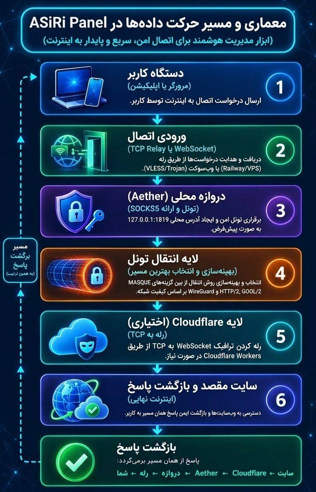
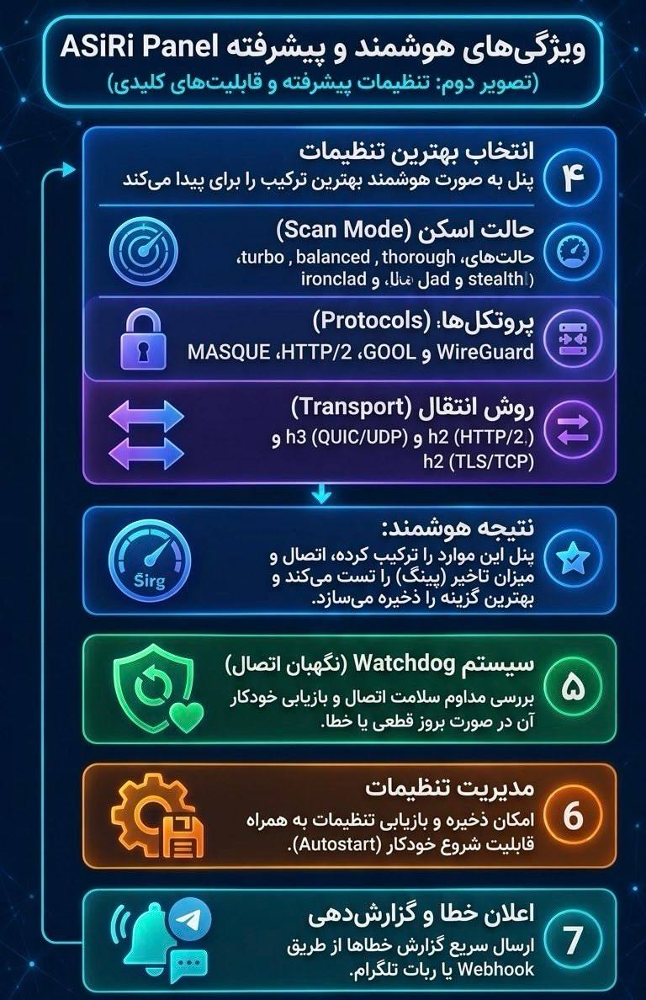

# ASiRi panel · پنل وب ASiRi (غیررسمیaether)

**[فارسی](#fa) · [English](#en)** · [راهنمای دپلوی / Deploy guide](README-DEPLOY.md) · [`.env.example`](.env.example)

> ⚠️ پروژه‌ی **غیررسمی** است و به CluvexStudio (سازندگان Aether) وابسته نیست. ASiRi panel فقط یک رابط وب برای اجرا و مدیریت تونل [Aether](https://github.com/CluvexStudio/Aether) است و خود Aether را دانلود و اجرا می‌کند.
> ⚠️ **Unofficial** and not affiliated with CluvexStudio (the authors of Aether). ASiRi panel is only a web interface that runs and manages the [Aether](https://github.com/CluvexStudio/Aether) tunnel; it downloads and launches Aether itself.
>
> 📚 این پروژه بیشتر جنبه‌ی **آموزشی** دارد و برای شناخت بهتر شبکه و امنیت ساخته شده است. استفاده از آن برخلاف قوانین کشور یا محل زندگی‌تان **بر عهده‌ی خود شخص** است و نویسنده هیچ مسئولیتی در این باره ندارد.
> 📚 This project is mainly **educational**, built to help people better understand networking and security. Any use that violates the laws that apply to you is **solely the user's own responsibility**, and the author accepts no liability for it.

---

<a id="fa"></a>
# 🇮🇷 فارسی

## فهرست
1. [این پروژه چیست؟](#fa-what)
2. [امکانات](#fa-features)
3. [معماری و پورت‌ها](#fa-arch)
4. [شروع سریع](#fa-quick)
5. [کار با پنل](#fa-panel)
6. [رله‌ها و لینک‌ها](#fa-relays)
7. [اتصال کلاینت‌ها](#fa-clients)
8. [ماندگاری و Volume](#fa-persist)
9. [پایداری: watchdog و AUTO_START](#fa-stability)
10. [اعلان‌ها](#fa-notify)
11. [مرجع متغیرهای محیطی](#fa-env)
12. [API داخلی](#fa-api)
13. [امنیت](#fa-security)
14. [عیب‌یابی](#fa-trouble)
15. [Cloudflare Worker (اختیاری)](#fa-worker)
16. [توسعه و تست](#fa-dev)
17. [قدردانی و مجوز](#fa-credits)

<a id="fa-what"></a>
## این پروژه چیست؟
[Aether](https://github.com/CluvexStudio/Aether) یک کلاینت تونل مبتنی بر Cloudflare است که فقط یک پراکسی SOCKS5 روی `127.0.0.1:1819` **داخل همان ماشین** باز می‌کند. ASiRi panel (یک برنامه‌ی Next.js) سه کار انجام می‌دهد:

1. Aether را اجرا و مدیریت می‌کند: شروع/توقف، لاگ زنده، تست اتصال، انتخاب پروتکل و حالت اسکن.
2. یک **gateway با نام کاربری و رمز** جلوی آن می‌گذارد و از دو رله به بیرون می‌رساند. نتیجه یک آدرس عمومی است که گوشی یا کامپیوترتان به آن وصل می‌شود.
3. تونل را **زنده نگه می‌دارد** (watchdog)، بهترین کانفیگ را پیدا می‌کند و در صورت قطعی اعلان می‌فرستد.

<a id="fa-features"></a>
## امکانات
- شروع/توقف با یک دکمه؛ پروتکل (`masque`، `wg`، `gool`، `mim`)، ترنسپورت (`h2`/`h3`)، حالت اسکن، نسخه‌ی IP، noize، پورت، پراکسی HTTP و اتصال سریع
- وضعیت زنده، gateway انتخاب‌شده، IP و کشور خروجی، تأخیر، مدت اتصال، لاگ و تست اتصال
- **دو رله‌ی مستقل:** رله‌ی TCP (Railway TCP Proxy یا VPS خودتان) و دامنه‌ی پنل (WebSocket روی ۴۴۳)
- **لینک‌ها:** SOCKS5 (`socks://` و `socks5://`)، لینک یک‌لمسی تلگرام، Shadowsocks AEAD (`ss://`)، HTTP CONNECT، VLESS+WS+TLS و Trojan+WS+TLS
- **Watchdog** با backoff نمایی و بازگشت خودکار به آخرین کانفیگ سالم
- **بهترین کانفیگ:** امتحان خودکار ترکیب پروتکل × ترنسپورت × حالت اسکن و ذخیره‌ی برنده
- ذخیره‌ی تنظیمات تونل روی دیسک (روی Volume) و `AUTO_START=1` برای اتصال خودکار بعد از هر ری‌استارت
- اعلان با Webhook (Slack/Discord/…) و ربات تلگرام
- Basic Auth روی کل پنل، محدودیت نرخ ورود ناموفق و کند کردن عمدی حدس رمز در gateway
- رابط ریسپانسیو و راست‌به‌چین

<a id="fa-arch"></a>
## معماری و پورت‌ها
```
                       ┌─► رله‌ی TCP (Railway / VPS) ──┐
کلاینت ──► رله‌ها ─────┤                               │
                       └─► دامنه‌ی پنل (WS/443) ───────┤
                                                       ▼
          gateway (نام کاربری/رمز) — تشخیص پروتکل از بایت‌های اول:
              SOCKS5 (user/pass) | HTTP CONNECT | Shadowsocks AEAD
                                   │
                                   ▼
          SOCKS5 محلی Aether (127.0.0.1:1819، بدون رمز) ──► Cloudflare
```
- هر رله **مستقل** است: وضعیت، retry و خطای خودش را دارد و خرابی یکی روی دیگری اثر ندارد.
- VLESS/Trojan از همان پورت HTTP پنل سرو می‌شود (`server.mjs`). لبه‌ی Railway/Render یا reverse proxy شما TLS را روی ۴۴۳ تمام می‌کند. فقط TCP پشتیبانی می‌شود (بدون UDP و mux).
- نسخه‌ی Aether در Dockerfile **پین** است (`ARG AETHER_VERSION=v1.5.0`) و checksum آن هنگام بیلد بررسی می‌شود.

| پورت | کاربرد | دسترسی |
| --- | --- | --- |
| `3000` (`PORT`) | پنل (HTTP) و WebSocket ورودی VLESS/Trojan | عمومی (ترجیحاً پشت HTTPS) |
| `RELAY_PORT` | رله‌ی TCP (gateway) | عمومی؛ فقط با نام کاربری/رمز محافظت می‌شود |
| `1819` | SOCKS5 محلی Aether (قابل تغییر در پنل) | فقط `127.0.0.1` |
| `1820` | پراکسی HTTP اختیاری Aether (پورت SOCKS + ۱) | فقط `127.0.0.1` |
| تصادفی (یا `GATEWAY_PORT`) | gateway داخلی | فقط `127.0.0.1` |

### تصاویر معرفی
<p align="center">
  
  
</p>
<p align="center"><sub>چپ: معماری و مسیر حرکت داده‌ها · راست: ویژگی‌های هوشمند و پیشرفته (بهترین تنظیمات، Watchdog، مدیریت تنظیمات و اعلان خطا)</sub></p>

### معماری موتور Aether
[Aether](https://github.com/CluvexStudio/Aether) یک هسته‌ی Rust در فضای کاربر است که تونل رمزنگاری‌شده را به لبه‌ی Cloudflare می‌زند و یک پراکسی SOCKS5 محلی می‌دهد.
```
برنامه‌ها (مرورگر، تلگرام، curl، …)
          │  SOCKS5 (بدون رمز)
          ▼
   127.0.0.1:1819  ◄── --bind / AETHER_SOCKS
          │
          ▼
   هسته‌ی Aether (Rust، userspace)
   ├─ اسکنر: turbo | balanced | thorough | stealth | ironclad
   ├─ noize: مبهم‌سازی شروع اتصال
   ├─ اعتبارسنجی داده: gateway فقط بعد از عبور داده‌ی واقعی پذیرفته می‌شود
   └─ اتصال مجدد خودکار + quick-reconnect به آخرین gateway سالم
          │
   ┌──────┼───────────────┐
   ▼      ▼               ▼
 MASQUE  WireGuard       gool
 h3: QUIC/UDP   UDP    WireGuard داخل WireGuard
 h2: TLS/TCP           (hop بیرونی ← hop داخلی)
   └──────┼───────────────┘
          ▼
   gateway لبه‌ی Cloudflare (با اسکن پیدا می‌شود)
          ▼
        اینترنت
```

| پورت / مسیر | کاربرد | دسترسی |
| --- | --- | --- |
| `1819` (TCP) | SOCKS5 محلی، **بدون رمز**؛ با `--bind` یا `AETHER_SOCKS` عوض می‌شود | فقط `127.0.0.1` |
| پورت SOCKS + ۱ (اختیاری) | پراکسی HTTP (`--http-proxy`)؛ پنل آن را روی `1820` باز می‌کند | فقط `127.0.0.1` |
| پورت gateway | با اسکن انتخاب می‌شود و تابع شبکه است. مثال‌های مستندات Aether: `443` (MASQUE) و `2408` (WireGuard/gool) | خروجی به Cloudflare |
| `/data` (فقط Docker خود Aether) | هویت WARP و آخرین gateway سالم (`*-lastconn.toml`) | Volume |

- MASQUE روی h3 از **UDP** (QUIC) و روی h2 از **TCP** (TLS) استفاده می‌کند. اگر شبکه UDP را می‌بندد یا کند می‌کند، `h2` را انتخاب کنید.
- پراکسی SOCKS5 خود Aether احراز هویت ندارد؛ در ASiRi panel همین پورت فقط به gateway داخلی پنل (با نام کاربری/رمز) وصل است و نباید مستقیم به اینترنت باز شود.

<a id="fa-quick"></a>
## شروع سریع
برای امتحان روی کامپیوتر یا سرور خودتان (نیازمند Docker با BuildKit، که در نسخه‌های جدید پیش‌فرض است):
```bash
git clone <آدرس-ریپوی-شما> asiri-panel && cd asiri-panel
docker build -t asiri-panel .
docker run -d --name asiri-panel --restart unless-stopped \
  -p 3000:3000 -p 1080:1080 \
  -e PANEL_USER=admin \
  -e PANEL_PASSWORD='یک-رمز-طولانی-و-تصادفی' \
  -e SHARE_USERNAME=myuser \
  -e SHARE_PASSWORD='رمز-اشتراک-طولانی' \
  -e RELAY_PORT=1080 \
  -e RELAY_PUBLIC_HOST=IP-یا-دامنه-سرور \
  -e RELAY_PUBLIC_PORT=1080 \
  -e AUTO_START=1 -e SHARE_AUTO=1 \
  -v asiri-data:/data -e TMPDIR=/data/tmp \
  asiri-panel
```
> خط `-v asiri-data:/data -e TMPDIR=/data/tmp` Volume را روی `/data` وصل می‌کند و داده‌های پنل را داخل آن می‌نویسد تا تنظیمات بعد از ری‌استارت بماند. توضیح کامل: [ماندگاری و Volume](#fa-persist).

۱. `http://localhost:3000` را باز کنید و با `PANEL_USER` / `PANEL_PASSWORD` وارد شوید.
۲. دکمه‌ی بزرگ اتصال را بزنید و صبر کنید وضعیت **متصل** شود.
۳. «ساخت آدرس عمومی» را بزنید (با `SHARE_AUTO=1` خودکار انجام می‌شود) و لینک را در کلاینت وارد کنید.

> بدون هیچ رله‌ای دکمه‌ی «ساخت آدرس عمومی» خطای `No relay is enabled…` می‌دهد. حداقل یکی لازم است: `RELAY_PORT` (رله‌ی TCP) یا دامنه‌ی HTTPS پنل برای VLESS/Trojan (`INBOUND_PUBLIC_HOST`، یا دامنه‌ی خودکار Railway/Render). مراحل Railway، Render و VPS در [README-DEPLOY.md](README-DEPLOY.md).

<a id="fa-panel"></a>
## کار با پنل

### تنظیمات تونل
فقط وقتی تونل **خاموش** است قابل تغییرند و با هر استارت روی دیسک ذخیره می‌شوند.

| گزینه | مقادیر | پیش‌فرض | توضیح |
| --- | --- | --- | --- |
| پروتکل | `masque` · `wg` · `gool` · `mim` | `masque` | |
| ترنسپورت | `h2` · `h3` | `h2` | برای `wg` اعمال نمی‌شود |
| حالت اسکن | `turbo` · `balanced` · `thorough` · `verified` · `ironclad` | `turbo` | `turbo` سریع‌ترین؛ `verified` و `ironclad` کندترین و دقیق‌ترین |
| نسخه‌ی IP | `4` · `6` · `dual` | `4` | |
| مبهم‌سازی (noize) | `default` · `off` · `light` · `firewall` · `balanced` · `gfw` · `aggressive` | `default` | `default` یعنی پرچمی به Aether داده نمی‌شود |
| پورت SOCKS5 | ۱۰۲۴ تا ۶۵۵۳۴ | `1819` | فقط روی `127.0.0.1` |
| پراکسی HTTP | روشن/خاموش | خاموش | روی `پورت + ۱` |
| اتصال سریع | روشن/خاموش | **روشن** | `--quick-reconnect` / `--no-quick-reconnect` |

اگر باینری Aether پیدا نشود (معمولاً فقط خارج از Docker)، به‌جای کارت اتصال، کارت «نصب Aether» نمایش داده می‌شود. دکمه‌ی نصب، نسخه‌ی پین‌شده (`AETHER_VERSION`) را دانلود و checksum آن را بررسی می‌کند. روی سیستم‌های غیر لینوکس یا معماری غیر x64/arm64 نصب پشتیبانی نمی‌شود.

### کارت‌ها
- **اتصال:** دکمه‌ی بزرگ شروع/توقف، وضعیت، مدت اتصال و Gateway انتخاب‌شده.
- **خروجی تونل:** IP، کشور، colo و تأخیر تا Cloudflare، به‌علاوه‌ی دکمه‌ی «تست اتصال از طریق پراکسی».
- **دسترسی از بیرون (اشتراک):** «ساخت آدرس عمومی» gateway و رله‌ها را روشن می‌کند و فقط وقتی تونل **متصل** است کار می‌کند. نام کاربری، رمز و لینک‌های هر رله و یک بلوک آماده‌ی کپی («کپی همه») اینجا نمایش داده می‌شود.
- **بهترین کانفیگ:** به‌طور پیش‌فرض همه‌ی پروتکل‌ها و ترنسپورت‌ها را با حالت‌های `turbo` و `balanced` امتحان می‌کند (برای `wg` ترنسپورت یک‌بار امتحان می‌شود؛ پس پیش‌فرض ۱۴ ترکیب است). برای هر کاندید تا `BEST_TIMEOUT_SEC` (پیش‌فرض ۴۵ ثانیه) صبر می‌کند، سه درخواست واقعی می‌فرستد و میانه‌ی تأخیر را می‌سنجد. برنده (کمترین تأخیر) ذخیره می‌شود و تونل با آن دوباره وصل می‌شود.
  - در این چند دقیقه تونل قطع و وصل می‌شود. «لغو جستجو» متوقفش می‌کند و در صورت لغو برنده اعمال نمی‌شود.
  - اگر هیچ کاندیدی وصل نشود، به آخرین کانفیگ سالم برمی‌گردد.
- **پایش و اعلان:** وضعیت watchdog، تعداد ری‌استارت‌ها، آخرین بررسی، دلیل آخرین قطعی و دکمه‌ی «ارسال اعلان آزمایشی».
- **لاگ‌ها:** ۲۵۰ خط آخر خروجی Aether (حداکثر ۵۰۰ خط در حافظه نگه داشته می‌شود).

### تنظیمات اشتراک
- نام کاربری ۳ تا ۳۲ کاراکتر، رمز ۸ تا ۶۴ کاراکتر؛ فقط `A-Za-z0-9._~-`.
- فقط وقتی اشتراک **خاموش** است قابل تغییر است تا لینکِ در حال استفاده زیر دست شما عوض نشود.
- ⚠️ مقدارها **فقط در حافظه‌ی پروسه** نگه داشته می‌شوند و روی دیسک (حتی روی Volume) نمی‌روند؛ با ری‌استارت پنل از متغیرهای `SHARE_*` خوانده می‌شوند. برای ثابت ماندن لینک‌ها آن‌ها را در Variables/Environment بگذارید ([ماندگاری](#fa-persist)).

<a id="fa-relays"></a>
## رله‌ها و لینک‌ها

| رله | آدرس | حداقل تنظیم |
| --- | --- | --- |
| TCP (Railway / VPS) | `host:port` ثابت | `RELAY_PORT` + (TCP Proxy در Railway **یا** `RELAY_PUBLIC_HOST` و `RELAY_PUBLIC_PORT`) |
| دامنه‌ی پنل (WebSocket) | `https://دامنه` روی ۴۴۳ | به‌صورت پیش‌فرض روشن؛ فقط به دامنه‌ی HTTPS پنل نیاز دارد (Railway/Render خودکار، وگرنه `INBOUND_PUBLIC_HOST`) |

**لینک‌های رله‌ی TCP** (نام پیش‌فرض: `ASiRi-Railway`، حتی روی VPS): `socks://`، `socks5://`، لینک تلگرام، `ss://` و `http://`، فقط برای پروتکل‌هایی که در `SHARE_PROTOCOLS` فعال‌اند. `SHARE_PROTOCOLS` (پیش‌فرض `socks,http,ss`) تعیین می‌کند هر پورت TCP کدام پروتکل‌ها را بپذیرد؛ مقدارهای نامعتبر نادیده گرفته می‌شوند و اگر هیچ‌کدام معتبر نباشد فقط `socks` فعال می‌ماند. رمز Shadowsocks همان رمز اشتراک است (نام کاربری استفاده نمی‌شود) و رمزگذار با `SS_CIPHER` انتخاب می‌شود: `chacha20-ietf-poly1305` (پیش‌فرض)، `aes-256-gcm`، `aes-128-gcm`.

**لینک‌های دامنه‌ی پنل:** `vless://` و `trojan://` (نام‌های `ASiRi-VLESS-WS` و `ASiRi-Trojan-WS`).
- مسیر WebSocket پیش‌فرض `/ws/<۱۲ کاراکتر hex>` است و فقط از **رمز اشتراک** مشتق می‌شود. برای مسیر دلخواه `INBOUND_WS_PATH=/my-secret-path` بگذارید (باید با `/` شروع شود، فقط `A-Za-z0-9._~-/` و نه `/api/` یا `/_next`).
- UUID از نام کاربری و رمز اشتراک مشتق می‌شود. رمز Trojan همان UUID است.
- برای خاموش‌کردن: `INBOUND_WS=off`؛ یا فقط یکی: `INBOUND_WS=vless` / `INBOUND_WS=trojan`.
- ⚠️ لینک‌های تولیدشده **همیشه** روی پورت `443` با TLS ساخته می‌شوند. `INBOUND_PUBLIC_PORT` و `INBOUND_TLS` فقط روی پورت نمایش‌داده‌شده و بررسی سلامت watchdog اثر دارند، نه روی متن لینک. اگر دامنه‌تان روی ۴۴۳ با TLS در دسترس نیست، لینک آماده کار نمی‌کند و باید آن را دستی ویرایش کنید.
- از هر IP حداکثر `INBOUND_MAX_PER_IP` (پیش‌فرض ۳۲) نشست هم‌زمان و در کل ۵۱۲ نشست مجاز است.

<a id="fa-clients"></a>
## اتصال کلاینت‌ها

| می‌خواهید… | لینک | کجا وارد کنید |
| --- | --- | --- |
| تلگرام | لینک یک‌لمسی `https://t.me/socks?...` («افزودن به تلگرام») | با کلیک روی لینک پراکسی اضافه می‌شود |
| اندروید / iOS / دسکتاپ (مثل v2rayNG، Streisand، Shadowrocket، Nekoray) | `ss://`، `vless://`، `trojan://` یا `socks://` | Import from clipboard / Add from URL |
| تنظیم دستی | سرور، پورت، نام کاربری و رمز از بلوک کپی | تنظیمات پراکسی برنامه یا سیستم‌عامل |

کدام لینک را انتخاب کنم؟
- **رمزنگاری‌شده و توصیه‌شده:** Shadowsocks، VLESS+WS+TLS، Trojan+WS+TLS.
- **SOCKS5 و HTTP CONNECT رمزنگاری ندارند.** نام کاربری، رمز و ترافیک بین کلاینت و رله متن ساده می‌رود (در پنل با «بدون رمزنگاری» مشخص شده). برای تلگرام راحت است ولی روی شبکه‌های ناامن توصیه نمی‌شود.
- VLESS/Trojan شبیه HTTPS معمولی روی ۴۴۳ دیده می‌شود و معمولاً در شبکه‌های سخت‌گیر بهتر عمل می‌کند.

تست از ترمینال:
```bash
curl --socks5-hostname HOST:PORT --proxy-user USER:PASS https://www.cloudflare.com/cdn-cgi/trace
```
خروجی باید `ip=` و `warp=` را نشان دهد.

<a id="fa-persist"></a>
## ماندگاری و Volume: چه چیزی بعد از ری‌استارت می‌ماند؟
پنل همه‌ی داده‌هایش را در `$TMPDIR/.aether` می‌نویسد. روی Railway، Render و Docker فایل‌سیستم کانتینر موقت است و با هر ری‌استارت یا دپلوی پاک می‌شود. برای ماندگاری باید **یک Volume به کانتینر وصل کنید** و **متغیر `TMPDIR` را داخل مسیر آن بگذارید**.

### سه چیزی که نباید با هم قاطی شوند

| مفهوم | یعنی چه | چه مقداری بگذارم |
| --- | --- | --- |
| **نام Volume** | برچسب دلخواه برای شناسایی در پلتفرم؛ پنل از آن استفاده نمی‌کند | هر نامی (مثلاً `asiri-data`) |
| **Mount path** | مسیر داخل کانتینر که Volume به آن وصل می‌شود | `/data` |
| **متغیر `TMPDIR`** | به پنل می‌گوید داده را کجا بنویسد. **باید با Mount path شروع شود** | `/data/tmp` |

با `TMPDIR=/data/tmp` داده‌ها در `/data/tmp/.aether` ذخیره می‌شوند. پوشه‌ها را خود پنل می‌سازد. اگر ساده‌تر می‌خواهید، `TMPDIR=/data` هم کار می‌کند.

### Railway
1. پروژه را باز کنید، **Add Volume** را بزنید (Ctrl/⌘+K یا راست‌کلیک روی بوم پروژه) و **سرویس پنل** را انتخاب کنید.
2. **Mount path:** `/data`. نام Volume را Railway خودش می‌گذارد و مهم نیست.
3. در **Variables** سرویس این را اضافه کنید:
   ```
   TMPDIR=/data/tmp
   ```
4. سرویس را **Redeploy** کنید.

`RAILWAY_VOLUME_MOUNT_PATH` را خود Railway می‌گذارد؛ دستی نگذارید. پنل با آن می‌فهمد `TMPDIR` داخل Volume است. هر Volume فقط به یک سرویس وصل می‌شود.

### Render
1. سرویس پنل ← **Disks ← Add Disk**.
2. **Name:** دلخواه. **Mount Path:** `/data`. **Size:** مثلاً ۱ GB.
3. در **Environment:** `TMPDIR=/data/tmp`
4. Disk فقط روی نمونه‌های پولی (غیررایگان) در دسترس است.

### Docker / VPS
```bash
docker run -d --name asiri-panel --restart unless-stopped \
  -v asiri-data:/data \
  -e TMPDIR=/data/tmp \
  ... سایر گزینه‌ها ... \
  asiri-panel
```
- `asiri-data` نام دلخواه Volume و `/data` مسیر داخل کانتینر است.
- برای پوشه‌ی مستقیم روی سرور (bind mount): `-v /opt/asiri/data:/data`
- کانتینر با کاربر root اجرا می‌شود؛ نیازی به chown نیست.

### چطور مطمئن شوم درست شد؟
- بنر «Settings and WARP identity will be lost on restart.» دیگر نمایش داده نمی‌شود.
- بعد از اولین استارت تونل، فایل `tunnel-config.json` باید وجود داشته باشد:
  ```bash
  docker exec asiri-panel ls -la /data/tmp/.aether
  ```
  روی Railway/Render همین مسیر را در Shell سرویس ببینید.
- سرویس را ری‌استارت کنید. تنظیمات تونل باید سر جایش باشد.

### اشتباهات رایج
- Volume ساخته‌اید ولی `TMPDIR` را نگذاشته‌اید: داده در `/tmp` نوشته می‌شود و می‌پرد.
- `TMPDIR` بیرون از Mount path است (مثلاً `/tmp/data` یا `/app/data`): بنر می‌ماند.
- `PERSISTENCE_OK=1` را بدون Volume گذاشته‌اید: فقط بنر پنهان می‌شود و چیزی ماندگار نمی‌شود.
- انتظار دارید رمز اشتراک هم روی Volume بماند: نمی‌ماند (جدول زیر).

### چه چیزی می‌ماند؟

| مورد | کجا ذخیره می‌شود | بعد از ری‌استارت |
| --- | --- | --- |
| تنظیمات تونل، آخرین کانفیگ سالم (`lastGood`) و برنده‌ی «بهترین کانفیگ» | `tunnel-config.json` در `$TMPDIR/.aether` (دسترسی ۰۶۰۰) | می‌ماند، **اگر Volume داشته باشید** |
| باینری Aether نصب‌شده از پنل (خارج از Docker) و هویت WARP | `$TMPDIR/.aether` | می‌ماند، **اگر Volume داشته باشید** |
| نام کاربری، رمز و «شروع خودکار» اشتراک | **فقط حافظه** (`process.env`) | **از دست می‌رود.** مقدار `SHARE_*` برمی‌گردد |
| اگر `SHARE_*` را نگذاشته باشید | تصادفی ساخته می‌شود | **با هر ری‌استارت عوض می‌شود** و چون UUID و مسیر VLESS/Trojan از آن‌ها مشتق می‌شوند، همه‌ی لینک‌ها هم عوض می‌شوند |

نتیجه: Volume برای تنظیمات تونل و هویت WARP است. برای لینک‌های ثابت، `SHARE_USERNAME` و `SHARE_PASSWORD` را حتماً در Variables/Environment بگذارید و برای اتصال خودکار بعد از ری‌استارت `AUTO_START=1` را فراموش نکنید. اگر مقدار `SHARE_*` نامعتبر باشد، پنل هشدار می‌دهد و تا ری‌استارت بعدی از مقدار تصادفی (با `SHARE_AUTO` خاموش) استفاده می‌کند.

<a id="fa-stability"></a>
## پایداری: watchdog و AUTO_START
- **AUTO_START=1:** بعد از هر ری‌استارت پنل، تونل با تنظیمات ذخیره‌شده (یا پیش‌فرض‌ها اگر چیزی ذخیره نشده) دوباره وصل می‌شود. با `SHARE_AUTO=1` رله‌ها هم با اتصال تونل روشن می‌شوند. راه‌اندازی از طریق یک درخواست داخلی با همان `PANEL_USER`/`PANEL_PASSWORD` انجام می‌شود، پس هر دو باید تنظیم باشند. بدون `AUTO_START`، بعد از ری‌استارت تونل خاموش می‌ماند. (برای اینکه «تنظیمات ذخیره‌شده» واقعاً بماند، Volume لازم است.)
- **Watchdog** هر ۵ ثانیه وضعیت را می‌سنجد و هر ۳۰ ثانیه یک health check واقعی انجام می‌دهد:
  - اگر اشتراک روشن و رله‌ی WebSocket فعال باشد، بررسی از **مسیر عمومی** انجام می‌شود: پنل به دامنه‌ی عمومی خودش وصل می‌شود، با VLESS یا Trojan یک درخواست به `www.cloudflare.com/cdn-cgi/trace` می‌فرستد و انتظار پاسخ ۲۰۰ دارد.
  - در غیر این صورت یک درخواست `curl` از پورت SOCKS5 محلی به همان آدرس می‌زند.
- **ری‌استارت** با backoff ۲، ۴، ۸، … تا سقف ۳۰۰ ثانیه در این حالت‌ها انجام می‌شود: پروسه مرده باشد؛ ۳ health check پشت‌سرهم شکست بخورد؛ بیش از ۵ دقیقه در حالت اسکن/اتصال گیر کند.
- بعد از ۳ استارت ناموفق پشت‌سرهم، اگر «کانفیگ سالم» متفاوتی ذخیره شده باشد، به آن برمی‌گردد. کانفیگی «سالم» ثبت می‌شود که حداقل ۶۰ ثانیه پایدار وصل مانده باشد.
- Watchdog فقط وقتی تونل را «خواسته‌اید» دخالت می‌کند: با «قطع» دستی کاری ندارد و در زمان «بهترین کانفیگ» کنار می‌ایستد.
- ⚠️ چون health check از مسیر عمومی است، اگر دامنه‌ی عمومی (`INBOUND_PUBLIC_HOST`) اشتباه باشد یا به همین پنل نرسد، watchdog تونل سالم را هم ری‌استارت می‌کند. اگر دامنه‌ی درست ندارید `INBOUND_WS=off` بگذارید.

<a id="fa-notify"></a>
## اعلان‌ها
- **Webhook:** `NOTIFY_WEBHOOK_URL` (فقط `http`/`https`)؛ درخواست POST با JSON `{source,event,text,content,ts,data}`. `text` برای Slack و `content` برای Discord پر می‌شود؛ مقدار `source` همیشه `"aether-panel"` است.
- **تلگرام:** در BotFather ربات بسازید، یک پیام به آن بدهید، `chat_id` را پیدا کنید و **هر دو** `NOTIFY_TELEGRAM_BOT_TOKEN` و `NOTIFY_TELEGRAM_CHAT_ID` را بگذارید. `NOTIFY_TELEGRAM_API` برای آدرس سفارشی API است.
- **رویدادها** (`NOTIFY_EVENTS`، پیش‌فرض همه):
  - `tunnel_down`: قطعی تونل و بازگشت به کانفیگ سالم
  - `subscription_changed`: لینک‌های رله ساخته یا عوض شدند
  - `relay_error`: خطای bind/راه‌اندازی رله یا تلاش‌های ناموفق ورود پشت‌سرهم به رله
- پیام تکراری (هم‌رویداد و هم‌کلید) تا `NOTIFY_COOLDOWN_SEC` (پیش‌فرض ۳۰۰؛ `0` یعنی بدون محدودیت) دوباره ارسال نمی‌شود.
- با «ارسال اعلان آزمایشی» تنظیمات را امتحان کنید؛ این پیام از فیلتر رویداد و cooldown مستثنی است.
- ⚠️ پیام `subscription_changed` شامل **نام کاربری، رمز و لینک‌های کامل** رله است؛ فقط به کانال‌هایی بفرستید که خودتان کنترل می‌کنید.

<a id="fa-env"></a>
## مرجع متغیرهای محیطی
نمونه‌ی توضیح‌دار و کامل: [`.env.example`](.env.example). مقدارهای عددی watchdog باید بزرگ‌تر از صفر باشند، وگرنه پیش‌فرض استفاده می‌شود.

**پایه**

| متغیر | پیش‌فرض | توضیح |
| --- | --- | --- |
| `PANEL_USER`، `PANEL_PASSWORD` | — | **الزامی.** اگر یکی خالی باشد پنل `503` می‌دهد |
| `PORT` | `3000` | پورت پنل (Railway/Render خودشان تنظیم می‌کنند) |
| `HOSTNAME_BIND` | `0.0.0.0` | آدرس bind پنل |
| `TMPDIR` | پوشه‌ی temp سیستم | محل داده‌ها (`$TMPDIR/.aether`). برای ماندگاری باید **داخل Mount path Volume** باشد، مثلاً `/data/tmp` ([ماندگاری](#fa-persist)) |
| `PERSISTENCE_OK` | — | `1` = فقط بنر ماندگاری پنهان شود؛ چیزی را ماندگار نمی‌کند |
| `AUTO_START` | — | `1` = اتصال خودکار تونل بعد از راه‌اندازی |
| `AETHER_BIN` | در Docker تنظیم است | مسیر باینری. جست‌وجو به‌ترتیب: `AETHER_BIN`، `$TMPDIR/.aether/aether`، `/tmp/aether/aether` |
| `AETHER_VERSION` | در Docker `v1.5.0` | نسخه‌ی پین‌شده برای installer داخل پنل. بدون آن آخرین Release دانلود می‌شود |

**اشتراک و gateway**

| متغیر | پیش‌فرض | توضیح |
| --- | --- | --- |
| `SHARE_USERNAME`، `SHARE_PASSWORD` | تصادفی | هر دو را بگذارید تا لینک‌ها بعد از ری‌استارت عوض نشوند |
| `SHARE_AUTO` | خاموش | `1` = رله‌ها با اتصال تونل روشن شوند |
| `SHARE_PROTOCOLS` | `socks,http,ss` | پروتکل‌های هر پورت TCP. فقط رمزنگاری‌شده: `ss` |
| `SS_CIPHER` | `chacha20-ietf-poly1305` | یا `aes-256-gcm` / `aes-128-gcm` |
| `GATEWAY_PORT` | تصادفی | پورت ثابت gateway داخلی (روی `127.0.0.1`) |
| `GATEWAY_IDLE_SEC` | `600` | مهلت بی‌کاری اتصال برقرارشده؛ به بازه‌ی ۳۰۰ تا ۶۰۰ محدود می‌شود |

**رله‌ها**

| متغیر | پیش‌فرض | توضیح |
| --- | --- | --- |
| `RELAY_PORT` | — | پورت رله‌ی TCP؛ نباید `PORT` یا `PORT+1` باشد. اگر تعریف نشده باشد و Railway TCP Proxy فعال باشد، `RAILWAY_TCP_APPLICATION_PORT` استفاده می‌شود |
| `RELAY_BIND_HOST` | `0.0.0.0` | آدرس bind رله |
| `RELAY_PUBLIC_HOST`، `RELAY_PUBLIC_PORT` | از Railway | آدرس عمومی رله‌ی TCP؛ خارج از Railway الزامی است |
| `INBOUND_WS` | `vless,trojan` | `vless`، `trojan`، هر دو، یا `off` |
| `INBOUND_WS_PATH` | مشتق از رمز | مسیر مخفی WebSocket |
| `INBOUND_PUBLIC_HOST` | `RAILWAY_PUBLIC_DOMAIN` یا `RENDER_EXTERNAL_HOSTNAME` | دامنه‌ی HTTPS در لینک‌ها و health check |
| `INBOUND_PUBLIC_PORT` | `443` (با TLS) | فقط نمایش و health check، نه متن لینک |
| `INBOUND_TLS` | روشن | `0`/`off` = health check با `ws://` (پورت پیش‌فرض ۸۰)؛ لینک‌ها همچنان TLS هستند |
| `INBOUND_MAX_PER_IP` | `32` | سقف نشست WebSocket هم‌زمان برای هر IP |

متغیرهایی که Railway خودش تزریق می‌کند: `RAILWAY_PUBLIC_DOMAIN`، `RAILWAY_TCP_PROXY_DOMAIN`، `RAILWAY_TCP_PROXY_PORT`، `RAILWAY_TCP_APPLICATION_PORT`، `RAILWAY_VOLUME_MOUNT_PATH`.

**Watchdog و بهترین کانفیگ**

| متغیر | پیش‌فرض | توضیح |
| --- | --- | --- |
| `WATCHDOG_TICK_SEC` | `5` | فاصله‌ی tick |
| `WATCHDOG_INTERVAL_SEC` | `30` | فاصله‌ی health check |
| `WATCHDOG_PROBE_TIMEOUT_SEC` | `10` | مهلت هر health check |
| `WATCHDOG_MAX_FAILURES` | `3` | شکست متوالی تا ری‌استارت |
| `WATCHDOG_STUCK_SEC` | `300` | ری‌استارت اگر این‌قدر در اسکن/اتصال بماند |
| `WATCHDOG_BACKOFF_BASE_SEC`، `WATCHDOG_BACKOFF_MAX_SEC` | `2`، `300` | backoff نمایی |
| `WATCHDOG_FALLBACK_AFTER` | `3` | استارت ناموفق تا بازگشت به کانفیگ سالم |
| `WATCHDOG_STABLE_SEC` | `60` | اتصال پایدار این‌قدر = «کانفیگ سالم» |
| `BEST_TIMEOUT_SEC` | `45` | مهلت اتصال هر کاندید |

**اعلان:** `NOTIFY_WEBHOOK_URL`، `NOTIFY_TELEGRAM_BOT_TOKEN`، `NOTIFY_TELEGRAM_CHAT_ID`، `NOTIFY_TELEGRAM_API` (`https://api.telegram.org`)، `NOTIFY_EVENTS` (همه)، `NOTIFY_COOLDOWN_SEC` (`300`).

<a id="fa-api"></a>
## API داخلی
همه‌ی مسیرها پشت Basic Auth هستند، به‌جز `/healthz`.

| مسیر | متد | کار |
| --- | --- | --- |
| `/healthz` | GET | سلامت سرویس؛ پاسخ `ok`، بدون رمز |
| `/api/aether/status` | GET | وضعیت کامل |
| `/api/aether/start` | POST | شروع تونل؛ بدنه‌ی JSON اختیاری با گزینه‌های تونل (مقدارهای نامعتبر با پیش‌فرض جایگزین می‌شوند) |
| `/api/aether/stop` | POST | توقف تونل و اشتراک |
| `/api/aether/test` | POST | تست اتصال از طریق پراکسی (trace Cloudflare) |
| `/api/aether/install` | POST | نصب باینری Aether |
| `/api/aether/best` | POST / GET | شروع جستجو (بدنه‌ی اختیاری `{protocols, transports, scans}`؛ محدودیت: ۸ درخواست در دقیقه) / وضعیت |
| `/api/aether/best/cancel` | POST | لغو جستجو |
| `/api/aether/share/start` | POST | روشن‌کردن اشتراک (فقط وقتی تونل متصل است) |
| `/api/aether/share/stop` | POST | خاموش‌کردن اشتراک |
| `/api/aether/share/settings` | POST | بدنه‌ی `{username, password, auto}`؛ فقط وقتی اشتراک خاموش است |
| `/api/aether/notify/test` | POST | اعلان آزمایشی (محدودیت نرخ مشترک) |
| `/api/aether/boot` | POST | راه‌اندازی اولیه (خودکار و idempotent) |

مثال: `curl -u admin:PASSWORD https://دامنه/api/aether/status`

<a id="fa-security"></a>
## امنیت
- رمز پنل و رمز اشتراک را **طولانی و تصادفی** بگذارید و پنل را فقط روی HTTPS باز کنید. Railway و Render خودکار HTTPS می‌دهند؛ روی VPS از Caddy یا Nginx استفاده کنید.
- ورود ناموفق به پنل محدود می‌شود: بیش از ۲۰ تلاش اشتباه در ۱۰ دقیقه از یک IP، همان IP را ۱۰ دقیقه بلاک می‌کند (`429`). IP از هدر `X-Real-IP` و در نبودش از آخرین مقدار `X-Forwarded-For` خوانده می‌شود، پس پنل را پشت reverse proxy بگذارید و پورت ۳۰۰۰ را مستقیم به اینترنت باز نکنید؛ وگرنه این هدرها قابل جعل‌اند و محدودیت دور زده می‌شود.
- gateway رله به ورود اشتباه عمداً کند پاسخ می‌دهد (از ۰٫۲۵ تا ۵ ثانیه) و پروب‌های Shadowsocks را بی‌صدا قطع می‌کند. بیش از ۱۰ ورود اشتباه در دقیقه یک اعلان `relay_error` می‌فرستد، اما IP بلاک نمی‌شود (پشت پراکسی‌ها همه یک IP دیده می‌شوند).
- `RELAY_PORT` از اینترنت در دسترس است و تنها محافظ آن نام کاربری/رمز است. رمز قوی بگذارید و در صورت نیاز فقط Shadowsocks را فعال کنید: `SHARE_PROTOCOLS=ss`.
- مسیر WebSocket (VLESS/Trojan) عمداً Basic Auth ندارد (کلاینت‌ها نمی‌توانند) و فقط با مسیر مخفی و UUID/رمزِ مشتق‌شده از اطلاعات اشتراک محافظت می‌شود؛ آن‌ها را لو ندهید. وقتی اشتراک خاموش است، این مسیر `404` می‌دهد.
- SOCKS5 و HTTP CONNECT رمزنگاری‌شده نیستند؛ برای شبکه‌های ناامن از Shadowsocks/VLESS/Trojan استفاده کنید.
- اعلان `subscription_changed` رمز را شامل می‌شود؛ فقط به کانال خصوصی بفرستید.
- فایل تنظیمات تونل با دسترسی ۰۶۰۰ روی Volume نوشته می‌شود و رمز اشتراک را شامل نمی‌شود.
- هدرهای امنیتی پیش‌فرض Next.js تنظیم شده‌اند: `X-Content-Type-Options`، `Strict-Transport-Security`، `X-Frame-Options`، `Referrer-Policy` و `Permissions-Policy`.

<a id="fa-trouble"></a>
## عیب‌یابی

| مشکل | علت و راه‌حل |
| --- | --- |
| پنل `503` می‌دهد | `PANEL_USER` و `PANEL_PASSWORD` را تنظیم کنید |
| پنل `429` می‌دهد | ورود ناموفق زیاد؛ ۱۰ دقیقه صبر کنید |
| بنر «Settings and WARP identity…» | Volume بسازید (Mount path: `/data`) و `TMPDIR=/data/tmp` بگذارید؛ `TMPDIR` باید داخل Mount path باشد. جزئیات: [ماندگاری و Volume](#fa-persist) |
| تنظیمات تونل بعد از ری‌استارت پاک می‌شود | Volume وصل نیست یا `TMPDIR` بیرون از Mount path است؛ با `ls /data/tmp/.aether` بررسی کنید |
| «فایل اجرایی Aether پیدا نشد» | در Docker نباید رخ دهد؛ کارت نصب را بزنید یا `AETHER_BIN` را بررسی کنید |
| بیلد Docker با `unsupported arch` شکست می‌خورد | از BuildKit استفاده کنید (`docker buildx build`) و معماری amd64 یا arm64 باشد |
| تونل در scanning/connecting گیر می‌کند | حالت اسکن یا noize را عوض کنید یا «بهترین کانفیگ» را بزنید؛ watchdog بعد از ۵ دقیقه خودش ری‌استارت می‌کند |
| «ابتدا تونل را وصل کنید» هنگام ساخت آدرس | اشتراک فقط وقتی تونل متصل است شروع می‌شود |
| `No relay is enabled…` | حداقل یک رله لازم است: `RELAY_PORT` یا دامنه‌ی HTTPS پنل (`INBOUND_PUBLIC_HOST` / دامنه‌ی Railway/Render) |
| رله‌ی TCP در حالت «منتظر آدرس عمومی» | TCP Proxy را در Railway فعال کنید یا `RELAY_PUBLIC_HOST` و `RELAY_PUBLIC_PORT` بدهید |
| رله‌ی TCP «خطا» می‌دهد | `RELAY_PORT` با `PORT` یا `PORT+1` یکی است یا پورت اشغال است (از `1819`/`1820` هم استفاده نکنید) |
| لینک‌ها بعد از هر ری‌استارت عوض می‌شوند | `SHARE_USERNAME` و `SHARE_PASSWORD` را در متغیرهای محیطی بگذارید (Volume آن‌ها را نگه نمی‌دارد) |
| تونل هر چند دقیقه ری‌استارت می‌شود | health check از مسیر عمومی شکست می‌خورد: `INBOUND_PUBLIC_HOST`، گواهی TLS و ارسال هدر Upgrade در reverse proxy را بررسی کنید یا `INBOUND_WS=off` بگذارید |
| VLESS/Trojan وصل نمی‌شود | اشتراک باید روشن باشد؛ دامنه روی ۴۴۳ با TLS در دسترس باشد؛ مسیر درست باشد؛ reverse proxy هدر Upgrade را پاس دهد |
| «Too many requests» | محدودیت نرخ APIهای سنگین؛ چند ثانیه صبر کنید |
| بعد از ری‌استارت تونل وصل نمی‌شود | `AUTO_START=1` و وجود باینری را بررسی کنید |
| اعلان نمی‌رسد | «ارسال اعلان آزمایشی» را بزنید؛ توکن، `chat_id` یا Webhook را چک کنید |

<a id="fa-worker"></a>
## Cloudflare Worker (اختیاری)
> 📖 راهنمای کامل Worker: [worker/README.md](worker/README.md) · راهنمای دپلوی: [worker/README-DEPLOY.md](worker/README-DEPLOY.md)

پوشه‌ی `worker/` یک Worker مستقل است (بیرون از workspace پنل و از Dockerfile جداست). `worker/src/index.ts` دو کار می‌کند:
- درخواست WebSocket روی `WS_PATH` را به یک مقصد TCP خام (`TARGET_HOST:TARGET_PORT`) از طریق `cloudflare:sockets` وصل می‌کند و پیام‌های باینری را بدون هیچ پردازش پروتکلی رد و بدل می‌کند؛ پس مقصد باید همان پروتکلی را بفهمد که کلاینت می‌فرستد.
- هر درخواست دیگر (از جمله WebSocket روی مسیرهای دیگر) را به `ORIGIN` پراکسی می‌کند. با `ORIGIN` برابر آدرس پنل، دامنه‌ی Worker می‌تواند جلوی پنل قرار بگیرد و در پنل `INBOUND_PUBLIC_HOST` را روی دامنه‌ی Worker بگذارید. `WS_PATH` را روی مسیری بگذارید که با مسیر مخفی پنل یکی نباشد. اگر `ORIGIN` خالی باشد پاسخ `404` می‌دهد.

```bash
cd worker
npm install
# مقدارهای [vars] را در wrangler.toml تغییر دهید: ORIGIN, WS_PATH, TARGET_HOST, TARGET_PORT
npx wrangler deploy
```
مقدارهای فعلی `wrangler.toml` نمونه‌ی ساختگی‌اند و باید قبل از دپلوی عوض شوند. فایل `web/wrangler.toml` ورودی (`main`) ندارد و پنل از آن استفاده نمی‌کند؛ Worker قابل دپلوی همان `worker/` است.

<a id="fa-dev"></a>
## توسعه و تست
```bash
pnpm install
pnpm dev            # http://localhost:3000 (PANEL_USER و PANEL_PASSWORD را در محیط بگذارید)
pnpm typecheck
npm test            # فقط Node 22+؛ از aether و curl ساختگی استفاده می‌کند، نیازی به pnpm install ندارد
pnpm dev:ws         # اجرای server.mjs برای آزمایش WebSocket ورودی (VLESS/Trojan)
```
- `pnpm dev` به‌تنهایی هوک WebSocket را ندارد؛ برای آزمایش VLESS/Trojan از `pnpm dev:ws` استفاده کنید.
- ۱۴ تست: پیکربندی رله‌ها، لینک‌ها، rate limiter، backoff، اعلان‌ها، تشخیص ماندگاری، inbound و FrameParser، AUTO_START، watchdog و بهترین کانفیگ.
- ساختار: `web/lib/` منطق سرور، `web/app/api/aether/` مسیرهای API، `web/components/` رابط، `web/server.mjs` ورودی تولید، `worker/` Cloudflare Worker، `tests/` تست‌ها.
- مسیرهای `/api/aether/...` و نام متغیرهای `AETHER_*` عمداً تغییر نکرده‌اند، چون به برنامه‌ی Aether اشاره دارند.

<a id="fa-credits"></a>
## قدردانی و مجوز
- تونل: [Aether](https://github.com/CluvexStudio/Aether) ساخته‌ی CluvexStudio.
- نگهداری و به‌روزرسانی ASiRi panel: [soroushse7o](https://github.com/soroushse7o)
- مجوز: GNU AGPL v3؛ متن کامل در [LICENSE](LICENSE).

---

<a id="en"></a>
# 🇬🇧 English

## Contents
1. [What is this?](#en-what)
2. [Features](#en-features)
3. [Architecture and ports](#en-arch)
4. [Quick start](#en-quick)
5. [Using the panel](#en-panel)
6. [Relays and links](#en-relays)
7. [Connecting clients](#en-clients)
8. [Persistence and Volumes](#en-persist)
9. [Stability: watchdog and AUTO_START](#en-stability)
10. [Notifications](#en-notify)
11. [Environment reference](#en-env)
12. [Internal API](#en-api)
13. [Security](#en-security)
14. [Troubleshooting](#en-trouble)
15. [Cloudflare Worker (optional)](#en-worker)
16. [Development and tests](#en-dev)
17. [Credits and license](#en-credits)

<a id="en-what"></a>
## What is this?
[Aether](https://github.com/CluvexStudio/Aether) is a Cloudflare-based tunnel client that only opens a SOCKS5 proxy on `127.0.0.1:1819` **inside the same machine**. ASiRi panel (a Next.js app) does three things:

1. Runs and manages Aether: start/stop, live logs, connection test, protocol and scan-mode selection.
2. Puts a **username/password gateway** in front of it and publishes it through two relays, giving you a public address your phone or computer connects to.
3. **Keeps the tunnel alive** (watchdog), finds the best config and notifies you when something breaks.

<a id="en-features"></a>
## Features
- One-button start/stop; protocol (`masque`, `wg`, `gool`, `mim`), transport (`h2`/`h3`), scan mode, IP version, noize, port, HTTP proxy and quick reconnect
- Live status, selected gateway, exit IP/country, latency, uptime, logs and a connection test
- **Two independent relays:** a TCP relay (Railway TCP Proxy or your own VPS) and the panel domain (WebSocket on 443)
- **Links:** SOCKS5 (`socks://`, `socks5://`), one-tap Telegram link, Shadowsocks AEAD (`ss://`), HTTP CONNECT, VLESS+WS+TLS and Trojan+WS+TLS
- **Watchdog** with exponential backoff and automatic fallback to the last known-good config
- **Find best config:** tries protocol × transport × scan mode and saves the winner
- Tunnel settings persisted to disk (on a volume), plus `AUTO_START=1` to reconnect after every restart
- Webhook (Slack/Discord/…) and Telegram bot notifications
- Basic Auth on the whole panel, failed-login rate limiting, deliberately slowed brute-force on the gateway
- Responsive, RTL-aware UI

<a id="en-arch"></a>
## Architecture and ports
```
                       ┌─► TCP relay (Railway / VPS) ──┐
client ──► relays ─────┤                               │
                       └─► panel domain (WS/443) ──────┤
                                                       ▼
          gateway (username/password) — protocol sniffed from the first bytes:
              SOCKS5 (user/pass) | HTTP CONNECT | Shadowsocks AEAD
                                   │
                                   ▼
          local Aether SOCKS5 (127.0.0.1:1819, no auth) ──► Cloudflare
```
- Every relay is **independent**: own phase, retry and error; one failing never affects the other.
- VLESS/Trojan is served on the panel's own HTTP port (`server.mjs`). The Railway/Render edge or your reverse proxy terminates TLS on 443. TCP only (no UDP, no mux).
- The Aether version is **pinned** in the Dockerfile (`ARG AETHER_VERSION=v1.5.0`) and its checksum is verified at build time.

| Port | Purpose | Exposure |
| --- | --- | --- |
| `3000` (`PORT`) | Panel (HTTP) and the VLESS/Trojan WebSocket inbound | public (preferably behind HTTPS) |
| `RELAY_PORT` | TCP relay (gateway) | public; protected only by username/password |
| `1819` | local Aether SOCKS5 (changeable in the panel) | `127.0.0.1` only |
| `1820` | optional Aether HTTP proxy (SOCKS port + 1) | `127.0.0.1` only |
| random (or `GATEWAY_PORT`) | internal gateway | `127.0.0.1` only |

### Overview images
<p align="center">
  
  
</p>
<p align="center"><sub>Left: architecture and data flow · Right: smart and advanced features (best config, watchdog, settings management and error notifications). The images are in Persian.</sub></p>

### Aether engine architecture
[Aether](https://github.com/CluvexStudio/Aether) is a userspace Rust core that builds an encrypted tunnel to the Cloudflare edge and exposes a local SOCKS5 proxy.
```
apps (browser, Telegram, curl, …)
          │  SOCKS5 (no auth)
          ▼
   127.0.0.1:1819  ◄── --bind / AETHER_SOCKS
          │
          ▼
   Aether core (Rust, userspace)
   ├─ scanner: turbo | balanced | thorough | stealth | ironclad
   ├─ noize: obfuscates the start of the connection
   ├─ data-plane validation: a gateway is trusted only after real data flows
   └─ auto-reconnect + quick-reconnect to the last known-good gateway
          │
   ┌──────┼───────────────┐
   ▼      ▼               ▼
 MASQUE  WireGuard       gool
 h3: QUIC/UDP   UDP    WireGuard inside WireGuard
 h2: TLS/TCP           (outer hop ← inner hop)
   └──────┼───────────────┘
          ▼
   Cloudflare edge gateway (found by scanning)
          ▼
       internet
```

| Port / path | Purpose | Exposure |
| --- | --- | --- |
| `1819` (TCP) | local SOCKS5, **no authentication**; changed with `--bind` or `AETHER_SOCKS` | `127.0.0.1` only |
| SOCKS port + 1 (optional) | HTTP proxy (`--http-proxy`); the panel opens it on `1820` | `127.0.0.1` only |
| gateway port | chosen by the scan and network-dependent. Examples from Aether's docs: `443` (MASQUE) and `2408` (WireGuard/gool) | outbound to Cloudflare |
| `/data` (Aether's own Docker image only) | WARP identity and the last known-good gateway (`*-lastconn.toml`) | Volume |

- MASQUE uses **UDP** (QUIC) on h3 and **TCP** (TLS) on h2. If the network blocks or throttles UDP, choose `h2`.
- Aether's SOCKS5 proxy has no authentication; in ASiRi panel that port is reached only by the panel's internal gateway (which adds the username/password) and must never be exposed directly to the internet.

<a id="en-quick"></a>
## Quick start
To try it on your own machine or server (needs Docker with BuildKit, the default in current versions):
```bash
git clone <your-repo-url> asiri-panel && cd asiri-panel
docker build -t asiri-panel .
docker run -d --name asiri-panel --restart unless-stopped \
  -p 3000:3000 -p 1080:1080 \
  -e PANEL_USER=admin \
  -e PANEL_PASSWORD='a-long-random-password' \
  -e SHARE_USERNAME=myuser \
  -e SHARE_PASSWORD='a-long-share-password' \
  -e RELAY_PORT=1080 \
  -e RELAY_PUBLIC_HOST=YOUR.SERVER.IP.OR.DOMAIN \
  -e RELAY_PUBLIC_PORT=1080 \
  -e AUTO_START=1 -e SHARE_AUTO=1 \
  -v asiri-data:/data -e TMPDIR=/data/tmp \
  asiri-panel
```
> The line `-v asiri-data:/data -e TMPDIR=/data/tmp` attaches a volume at `/data` and makes the panel write its data inside it, so settings survive restarts. Full explanation: [Persistence and Volumes](#en-persist).

1. Open `http://localhost:3000` and sign in with `PANEL_USER` / `PANEL_PASSWORD`.
2. Press the big connect button and wait for **connected**.
3. Press "Create public address" (automatic with `SHARE_AUTO=1`) and import the link in your client.

> With no relay configured, the share button fails with `No relay is enabled…`. At least one is required: `RELAY_PORT` (TCP relay) or an HTTPS domain for VLESS/Trojan (`INBOUND_PUBLIC_HOST`, or the automatic Railway/Render domain). Step-by-step Railway, Render and VPS guides are in [README-DEPLOY.md](README-DEPLOY.md).

<a id="en-panel"></a>
## Using the panel

### Tunnel options
Editable only while the tunnel is **off**; saved to disk on every start.

| Option | Values | Default | Notes |
| --- | --- | --- | --- |
| Protocol | `masque` · `wg` · `gool` · `mim` | `masque` | |
| Transport | `h2` · `h3` | `h2` | not used with `wg` |
| Scan mode | `turbo` · `balanced` · `thorough` · `verified` · `ironclad` | `turbo` | `turbo` fastest; `verified` and `ironclad` slowest and most thorough |
| IP version | `4` · `6` · `dual` | `4` | |
| Obfuscation (noize) | `default` · `off` · `light` · `firewall` · `balanced` · `gfw` · `aggressive` | `default` | `default` passes no flag to Aether |
| SOCKS5 port | 1024–65534 | `1819` | `127.0.0.1` only |
| HTTP proxy | on/off | off | on `port + 1` |
| Quick reconnect | on/off | **on** | `--quick-reconnect` / `--no-quick-reconnect` |

If the Aether binary is missing (normally only outside Docker), an "Install Aether" card replaces the connection card. The button downloads the pinned release (`AETHER_VERSION`) and verifies its checksum. Non-Linux systems and architectures other than x64/arm64 are not supported by the installer.

### Cards
- **Connection:** the big start/stop button, status, uptime and the selected Gateway.
- **Tunnel exit:** IP, country, colo and latency to Cloudflare, plus a "test connection through the proxy" button.
- **Outside access (sharing):** "Create public address" starts the gateway and relays and works only while the tunnel is **connected**. It shows the username, password, every relay's links and a copy-ready block ("Copy all").
- **Best config:** by default tries every protocol and transport with the `turbo` and `balanced` scans (`wg` has no transport, so it is tried once per scan; the default is 14 combinations). Each candidate waits up to `BEST_TIMEOUT_SEC` (default 45 s), then three real requests are sent and the median latency is taken. The lowest latency wins, is saved, and the tunnel reconnects with it.
  - The tunnel drops for a few minutes meanwhile. Cancel stops the sweep; if you cancel, the winner is not applied.
  - If nothing connects, it falls back to the last known-good config.
- **Monitoring and notifications:** watchdog state, restart count, last check, the last outage reason and a "send test notification" button.
- **Logs:** the last 250 lines of Aether's output (up to 500 are kept in memory).

### Share settings
- Username 3–32 chars, password 8–64 chars; only `A-Za-z0-9._~-`.
- Editable only while sharing is **off**, so a link in use never changes under you.
- ⚠️ Values live **only in process memory** and are never written to disk (not even to a volume); after a panel restart they come from the `SHARE_*` variables again. Put them in the environment to keep links stable ([Persistence](#en-persist)).

<a id="en-relays"></a>
## Relays and links

| Relay | Address | Minimum setup |
| --- | --- | --- |
| TCP (Railway / VPS) | fixed `host:port` | `RELAY_PORT` + (Railway TCP Proxy **or** `RELAY_PUBLIC_HOST` and `RELAY_PUBLIC_PORT`) |
| Panel domain (WebSocket) | `https://domain` on 443 | on by default; only needs the panel's HTTPS domain (automatic on Railway/Render, otherwise `INBOUND_PUBLIC_HOST`) |

**TCP relay links** (default name `ASiRi-Railway`, even on a VPS): `socks://`, `socks5://`, the Telegram link, `ss://` and `http://`, only for protocols enabled in `SHARE_PROTOCOLS`. `SHARE_PROTOCOLS` (default `socks,http,ss`) decides which protocols every TCP port accepts; invalid entries are ignored, and if none is valid only `socks` stays on. The Shadowsocks password is the share password (the username is unused) and the cipher is chosen with `SS_CIPHER`: `chacha20-ietf-poly1305` (default), `aes-256-gcm`, `aes-128-gcm`.

**Panel domain links:** `vless://` and `trojan://` (named `ASiRi-VLESS-WS` and `ASiRi-Trojan-WS`).
- The default WebSocket path is `/ws/<12 hex chars>`, derived from the **share password** only. For a custom one set `INBOUND_WS_PATH=/my-secret-path` (must start with `/`, only `A-Za-z0-9._~-/`, not `/api/` or `/_next`).
- The UUID is derived from the share username and password. The Trojan password is that UUID.
- Disable with `INBOUND_WS=off`, or keep one: `INBOUND_WS=vless` / `INBOUND_WS=trojan`.
- ⚠️ Generated links **always** use port `443` with TLS. `INBOUND_PUBLIC_PORT` and `INBOUND_TLS` only affect the displayed port and the watchdog's health check, not the link text. If your domain isn't reachable on 443 with TLS, the generated link won't work and you must edit it by hand.
- At most `INBOUND_MAX_PER_IP` (default 32) concurrent sessions per IP and 512 in total.

<a id="en-clients"></a>
## Connecting clients

| You want… | Link | Where to enter it |
| --- | --- | --- |
| Telegram | one-tap `https://t.me/socks?...` ("Add to Telegram") | clicking it adds the proxy |
| Android / iOS / desktop (v2rayNG, Streisand, Shadowrocket, Nekoray and similar) | `ss://`, `vless://`, `trojan://` or `socks://` | Import from clipboard / Add from URL |
| Manual setup | server, port, username, password from the copy block | the app's or OS proxy settings |

Which link should I pick?
- **Encrypted, recommended:** Shadowsocks, VLESS+WS+TLS, Trojan+WS+TLS.
- **SOCKS5 and HTTP CONNECT are not encrypted.** Credentials and traffic between client and relay travel in clear text (marked "unencrypted" in the panel). Convenient for Telegram, not recommended on untrusted networks.
- VLESS/Trojan looks like ordinary HTTPS on 443 and usually fares better on restrictive networks.

Test from a terminal:
```bash
curl --socks5-hostname HOST:PORT --proxy-user USER:PASS https://www.cloudflare.com/cdn-cgi/trace
```
The output should include `ip=` and `warp=`.

<a id="en-persist"></a>
## Persistence and Volumes: what survives a restart?
The panel writes all its data to `$TMPDIR/.aether`. On Railway, Render and Docker the container filesystem is ephemeral and is wiped on every restart or deploy. To persist data you must **attach a Volume** and **point `TMPDIR` inside its mount path**.

### Three things not to mix up

| Concept | Meaning | What to set |
| --- | --- | --- |
| **Volume name** | free-form label in the platform UI; the panel never uses it | anything (e.g. `asiri-data`) |
| **Mount path** | where the volume appears inside the container | `/data` |
| **`TMPDIR` variable** | tells the panel where to write. **Must start with the mount path** | `/data/tmp` |

With `TMPDIR=/data/tmp` the data lives in `/data/tmp/.aether`. The panel creates the folders itself. `TMPDIR=/data` also works if you prefer it simpler.

### Railway
1. Open the project, choose **Add Volume** (Ctrl/⌘+K or right-click the canvas) and select the **panel service**.
2. **Mount path:** `/data`. Railway picks the volume name; it doesn't matter.
3. In the service **Variables** add:
   ```
   TMPDIR=/data/tmp
   ```
4. **Redeploy** the service.

Railway injects `RAILWAY_VOLUME_MOUNT_PATH` itself; don't set it by hand. The panel uses it to recognise that `TMPDIR` is on the volume. A volume attaches to a single service.

### Render
1. Service ← **Disks ← Add Disk**.
2. **Name:** anything. **Mount Path:** `/data`. **Size:** e.g. 1 GB.
3. In **Environment:** `TMPDIR=/data/tmp`
4. Disks are only available on paid (non-free) instances.

### Docker / VPS
```bash
docker run -d --name asiri-panel --restart unless-stopped \
  -v asiri-data:/data \
  -e TMPDIR=/data/tmp \
  ... other options ... \
  asiri-panel
```
- `asiri-data` is any volume name, `/data` the path inside the container.
- For a plain host folder (bind mount): `-v /opt/asiri/data:/data`
- The container runs as root, so no chown is needed.

### How do I know it works?
- The "Settings and WARP identity will be lost on restart." banner is gone.
- After the first tunnel start, `tunnel-config.json` exists:
  ```bash
  docker exec asiri-panel ls -la /data/tmp/.aether
  ```
  On Railway/Render, check the same path in the service shell.
- Restart the service; the tunnel settings are still there.

### Common mistakes
- A volume is attached but `TMPDIR` is unset: data goes to `/tmp` and is lost.
- `TMPDIR` is outside the mount path (e.g. `/tmp/data` or `/app/data`): the banner stays.
- `PERSISTENCE_OK=1` without a volume: it only hides the banner and persists nothing.
- Expecting the share credentials to live on the volume: they don't (table below).

### What survives?

| Item | Stored in | After a restart |
| --- | --- | --- |
| Tunnel options, last known-good config (`lastGood`) and the "Best config" winner | `tunnel-config.json` in `$TMPDIR/.aether` (mode 0600) | kept, **if you have a volume** |
| Aether binary installed from the panel (outside Docker) and the WARP identity | `$TMPDIR/.aether` | kept, **if you have a volume** |
| Share username, password and "auto start" | **memory only** (`process.env`) | **lost.** The `SHARE_*` variables apply again |
| If `SHARE_*` is unset | random values are generated | **change on every restart**; since the VLESS/Trojan UUID and path derive from them, every link changes too |

Bottom line: the volume is for tunnel settings and the WARP identity. For stable links, set `SHARE_USERNAME` and `SHARE_PASSWORD` as environment variables, and add `AUTO_START=1` to reconnect automatically after a restart. If the `SHARE_*` values are invalid the panel warns and uses random values (with `SHARE_AUTO` off) until the next restart.

<a id="en-stability"></a>
## Stability: watchdog and AUTO_START
- **AUTO_START=1:** after every panel restart the tunnel reconnects with the saved config (or defaults if nothing was saved). With `SHARE_AUTO=1` the relays come up when the tunnel connects. The boot goes through an internal authenticated request, so both `PANEL_USER` and `PANEL_PASSWORD` must be set. Without `AUTO_START` the tunnel stays off after a restart. (The "saved config" only survives restarts if you have a volume.)
- **Watchdog** ticks every 5 s and runs a real health check every 30 s:
  - If sharing is on and the WebSocket relay is active, the check goes through the **public path**: the panel connects to its own public domain, sends a request to `www.cloudflare.com/cdn-cgi/trace` over VLESS or Trojan and expects a 200.
  - Otherwise it runs a `curl` request through the local SOCKS5 port to the same URL.
- **It restarts** with backoff 2, 4, 8 … up to 300 s when: the process died; 3 consecutive health checks failed; it has been stuck scanning/connecting for over 5 minutes.
- After 3 failed starts in a row it falls back to the saved known-good config if that differs from the failing one. A config counts as "good" after staying connected for at least 60 s.
- It acts only while you want the tunnel up: a manual stop is respected and it stays out of the way during best-config sweeps.
- ⚠️ Because the health check uses the public path, a wrong `INBOUND_PUBLIC_HOST` (or one that doesn't reach this panel) makes the watchdog restart a healthy tunnel. If you have no proper domain, set `INBOUND_WS=off`.

<a id="en-notify"></a>
## Notifications
- **Webhook:** `NOTIFY_WEBHOOK_URL` (`http`/`https` only); POST JSON `{source,event,text,content,ts,data}`. `text` is for Slack and `content` for Discord; `source` is always `"aether-panel"`.
- **Telegram:** create a bot with BotFather, message it, find your `chat_id`, and set **both** `NOTIFY_TELEGRAM_BOT_TOKEN` and `NOTIFY_TELEGRAM_CHAT_ID`. `NOTIFY_TELEGRAM_API` sets a custom API base.
- **Events** (`NOTIFY_EVENTS`, default all):
  - `tunnel_down`: tunnel outage and fallback to a known-good config
  - `subscription_changed`: relay links were created or changed
  - `relay_error`: relay bind/start errors or repeated failed relay logins
- Repeats (same event and key) are suppressed for `NOTIFY_COOLDOWN_SEC` (default 300; `0` disables the cooldown).
- Use "send test notification" to verify your setup; it bypasses the event filter and the cooldown.
- ⚠️ `subscription_changed` messages contain the **username, password and full links**; only use channels you control.

<a id="en-env"></a>
## Environment reference
Full commented sample: [`.env.example`](.env.example). Numeric watchdog values must be greater than zero, otherwise the default is used.

**Core**

| Variable | Default | Description |
| --- | --- | --- |
| `PANEL_USER`, `PANEL_PASSWORD` | — | **Required.** If either is empty the panel returns `503` |
| `PORT` | `3000` | panel port (Railway/Render set it themselves) |
| `HOSTNAME_BIND` | `0.0.0.0` | panel bind address |
| `TMPDIR` | OS temp dir | data directory (`$TMPDIR/.aether`). To persist, it must be **inside the volume's mount path**, e.g. `/data/tmp` ([Persistence](#en-persist)) |
| `PERSISTENCE_OK` | — | `1` only hides the persistence banner; it persists nothing |
| `AUTO_START` | — | `1` starts the tunnel on boot |
| `AETHER_BIN` | preset in Docker | binary path. Lookup order: `AETHER_BIN`, `$TMPDIR/.aether/aether`, `/tmp/aether/aether` |
| `AETHER_VERSION` | `v1.5.0` in Docker | pins the in-panel installer. Without it the latest release is downloaded |

**Sharing and gateway**

| Variable | Default | Description |
| --- | --- | --- |
| `SHARE_USERNAME`, `SHARE_PASSWORD` | random | set both so links survive restarts |
| `SHARE_AUTO` | off | `1` starts the relays when the tunnel connects |
| `SHARE_PROTOCOLS` | `socks,http,ss` | protocols per TCP port. Encrypted only: `ss` |
| `SS_CIPHER` | `chacha20-ietf-poly1305` | or `aes-256-gcm` / `aes-128-gcm` |
| `GATEWAY_PORT` | random | fixed internal gateway port (on `127.0.0.1`) |
| `GATEWAY_IDLE_SEC` | `600` | idle timeout of established connections; clamped to 300–600 |

**Relays**

| Variable | Default | Description |
| --- | --- | --- |
| `RELAY_PORT` | — | TCP relay port; must not be `PORT` or `PORT+1`. If unset and a Railway TCP Proxy exists, `RAILWAY_TCP_APPLICATION_PORT` is used |
| `RELAY_BIND_HOST` | `0.0.0.0` | relay bind address |
| `RELAY_PUBLIC_HOST`, `RELAY_PUBLIC_PORT` | from Railway | public address of the TCP relay; required outside Railway |
| `INBOUND_WS` | `vless,trojan` | `vless`, `trojan`, both, or `off` |
| `INBOUND_WS_PATH` | derived | secret WebSocket path |
| `INBOUND_PUBLIC_HOST` | `RAILWAY_PUBLIC_DOMAIN` or `RENDER_EXTERNAL_HOSTNAME` | HTTPS domain used in links and the health check |
| `INBOUND_PUBLIC_PORT` | `443` (with TLS) | display and health check only, not the link text |
| `INBOUND_TLS` | on | `0`/`off` = health check over `ws://` (default port 80); links stay TLS |
| `INBOUND_MAX_PER_IP` | `32` | concurrent WebSocket sessions per IP |

Variables Railway injects itself: `RAILWAY_PUBLIC_DOMAIN`, `RAILWAY_TCP_PROXY_DOMAIN`, `RAILWAY_TCP_PROXY_PORT`, `RAILWAY_TCP_APPLICATION_PORT`, `RAILWAY_VOLUME_MOUNT_PATH`.

**Watchdog and best-config**

| Variable | Default | Description |
| --- | --- | --- |
| `WATCHDOG_TICK_SEC` | `5` | tick period |
| `WATCHDOG_INTERVAL_SEC` | `30` | health-check period |
| `WATCHDOG_PROBE_TIMEOUT_SEC` | `10` | per health-check timeout |
| `WATCHDOG_MAX_FAILURES` | `3` | consecutive failures before restart |
| `WATCHDOG_STUCK_SEC` | `300` | restart if stuck scanning/connecting this long |
| `WATCHDOG_BACKOFF_BASE_SEC`, `WATCHDOG_BACKOFF_MAX_SEC` | `2`, `300` | exponential backoff |
| `WATCHDOG_FALLBACK_AFTER` | `3` | failed starts before falling back |
| `WATCHDOG_STABLE_SEC` | `60` | connected this long = known-good |
| `BEST_TIMEOUT_SEC` | `45` | per-candidate connect timeout |

**Notifications:** `NOTIFY_WEBHOOK_URL`, `NOTIFY_TELEGRAM_BOT_TOKEN`, `NOTIFY_TELEGRAM_CHAT_ID`, `NOTIFY_TELEGRAM_API` (`https://api.telegram.org`), `NOTIFY_EVENTS` (all), `NOTIFY_COOLDOWN_SEC` (`300`).

<a id="en-api"></a>
## Internal API
All routes are behind Basic Auth, except `/healthz`.

| Route | Method | Purpose |
| --- | --- | --- |
| `/healthz` | GET | service health; returns `ok`, no auth |
| `/api/aether/status` | GET | full status |
| `/api/aether/start` | POST | start the tunnel; optional JSON body with tunnel options (invalid values fall back to defaults) |
| `/api/aether/stop` | POST | stop the tunnel and sharing |
| `/api/aether/test` | POST | connection test through the proxy (Cloudflare trace) |
| `/api/aether/install` | POST | install the Aether binary |
| `/api/aether/best` | POST / GET | start a sweep (optional body `{protocols, transports, scans}`; rate limit: 8 requests per minute) / status |
| `/api/aether/best/cancel` | POST | cancel the sweep |
| `/api/aether/share/start` | POST | turn sharing on (only while the tunnel is connected) |
| `/api/aether/share/stop` | POST | turn sharing off |
| `/api/aether/share/settings` | POST | body `{username, password, auto}`; only while sharing is off |
| `/api/aether/notify/test` | POST | test notification (shared rate limit) |
| `/api/aether/boot` | POST | initial boot (automatic; idempotent) |

Example: `curl -u admin:PASSWORD https://your-domain/api/aether/status`

<a id="en-security"></a>
## Security
- Use **long random passwords** for the panel and the share credentials, and expose the panel over HTTPS only. Railway and Render provide HTTPS automatically; on a VPS use Caddy or Nginx.
- Failed panel logins are rate-limited: more than 20 wrong attempts in 10 minutes from one IP block that IP for 10 minutes (`429`). The IP is read from `X-Real-IP`, otherwise the last `X-Forwarded-For` entry, so keep the panel behind a reverse proxy and don't expose port 3000 directly to the internet; otherwise those headers can be forged and the limit bypassed.
- The relay gateway deliberately slows down wrong logins (0.25 to 5 s) and silently drops Shadowsocks probes. More than 10 wrong logins per minute send one `relay_error` notification, but the IP is not blocked (behind proxies every client looks like the same IP).
- `RELAY_PORT` is reachable from the internet and the username/password is its only protection. Use strong credentials and, if you like, enable only Shadowsocks: `SHARE_PROTOCOLS=ss`.
- The WebSocket path (VLESS/Trojan) intentionally has no Basic Auth (clients can't send it) and is protected only by the secret path and the UUID/password derived from the share credentials; do not leak them. While sharing is off this path returns `404`.
- SOCKS5 and HTTP CONNECT are not encrypted; use Shadowsocks/VLESS/Trojan on untrusted networks.
- `subscription_changed` notifications include the credentials; send them to private channels only.
- The tunnel config file is written to the volume with mode 0600 and does not contain the share credentials.
- Standard security headers are set by Next.js config: `X-Content-Type-Options`, `Strict-Transport-Security`, `X-Frame-Options`, `Referrer-Policy` and `Permissions-Policy`.

<a id="en-trouble"></a>
## Troubleshooting

| Problem | Cause and fix |
| --- | --- |
| Panel returns `503` | set `PANEL_USER` and `PANEL_PASSWORD` |
| Panel returns `429` | too many failed logins; wait 10 minutes |
| "Settings and WARP identity…" banner | attach a volume (mount path `/data`) and set `TMPDIR=/data/tmp`; `TMPDIR` must be inside the mount path. Details: [Persistence and Volumes](#en-persist) |
| Tunnel settings vanish after a restart | the volume isn't attached or `TMPDIR` is outside the mount path; check with `ls /data/tmp/.aether` |
| "Aether binary not found" | shouldn't happen in Docker; press the install card or check `AETHER_BIN` |
| Docker build fails with `unsupported arch` | use BuildKit (`docker buildx build`) and an amd64 or arm64 host |
| Tunnel stuck in scanning/connecting | change scan mode or noize, or run "Find best config"; the watchdog restarts it after 5 minutes |
| "Connect the tunnel first" when sharing | sharing starts only while the tunnel is connected |
| `No relay is enabled…` | at least one relay is needed: `RELAY_PORT` or the panel's HTTPS domain (`INBOUND_PUBLIC_HOST` / the Railway/Render domain) |
| TCP relay "pending" | enable TCP Proxy on Railway or set `RELAY_PUBLIC_HOST` and `RELAY_PUBLIC_PORT` |
| TCP relay "error" | `RELAY_PORT` equals `PORT` or `PORT+1`, or is in use (also avoid `1819`/`1820`) |
| Links change after every restart | set `SHARE_USERNAME` and `SHARE_PASSWORD` as environment variables (a volume does not keep them) |
| Tunnel restarts every few minutes | the public-path health check fails: check `INBOUND_PUBLIC_HOST`, the TLS certificate and that the reverse proxy forwards the Upgrade header, or set `INBOUND_WS=off` |
| VLESS/Trojan won't connect | sharing must be on; the domain must be reachable on 443 with TLS; the path must be right; the reverse proxy must forward the Upgrade header |
| "Too many requests" | rate limit on heavy endpoints; wait a few seconds |
| Tunnel not up after restart | check `AUTO_START=1` and that the binary exists |
| No notifications | use "send test notification"; check token/chat_id or webhook |

<a id="en-worker"></a>
## Cloudflare Worker (optional)
> 📖 Full Worker docs: [worker/README.md](worker/README.md) · Deploy guide: [worker/README-DEPLOY.md](worker/README-DEPLOY.md)

The `worker/` folder is a standalone Worker (outside the panel's workspace and the Dockerfile). `worker/src/index.ts` does two things:
- It bridges a WebSocket on `WS_PATH` to a raw TCP target (`TARGET_HOST:TARGET_PORT`) through `cloudflare:sockets`, passing binary messages through with no protocol handling; the target must therefore understand whatever protocol your client sends.
- Every other request (including WebSockets on other paths) is reverse-proxied to `ORIGIN`. With `ORIGIN` set to your panel's URL, the Worker domain can sit in front of the panel; then set `INBOUND_PUBLIC_HOST` in the panel to the Worker domain. Choose a `WS_PATH` that differs from the panel's secret path. If `ORIGIN` is empty it answers `404`.

```bash
cd worker
npm install
# edit the [vars] in wrangler.toml: ORIGIN, WS_PATH, TARGET_HOST, TARGET_PORT
npx wrangler deploy
```
The current `wrangler.toml` values are mock placeholders and must be replaced before deploying. `web/wrangler.toml` has no `main` entry and is not used by the panel; the deployable Worker is `worker/`.

<a id="en-dev"></a>
## Development and tests
```bash
pnpm install
pnpm dev            # http://localhost:3000 (set PANEL_USER and PANEL_PASSWORD)
pnpm typecheck
npm test            # Node 22+ only; uses a fake aether and curl, no pnpm install needed
pnpm dev:ws         # run server.mjs to try the WebSocket inbound (VLESS/Trojan)
```
- `pnpm dev` alone has no WebSocket hook; use `pnpm dev:ws` to try VLESS/Trojan.
- 14 tests: relay config, links, rate limiter, backoff, notifier, persistence detection, the inbound and FrameParser, AUTO_START, the watchdog and best-config.
- Layout: `web/lib/` server logic, `web/app/api/aether/` API routes, `web/components/` UI, `web/server.mjs` production entry point, `worker/` Cloudflare Worker, `tests/` tests.
- The `/api/aether/...` routes and the `AETHER_*` variables are intentionally unchanged because they refer to the Aether program itself.

<a id="en-credits"></a>
## Credits and license
- Tunnel: [Aether](https://github.com/CluvexStudio/Aether) by CluvexStudio.
- ASiRi panel maintained and updated by [soroushse7o](https://github.com/soroushse7o)
- License: GNU AGPL v3; full text in [LICENSE](LICENSE).
